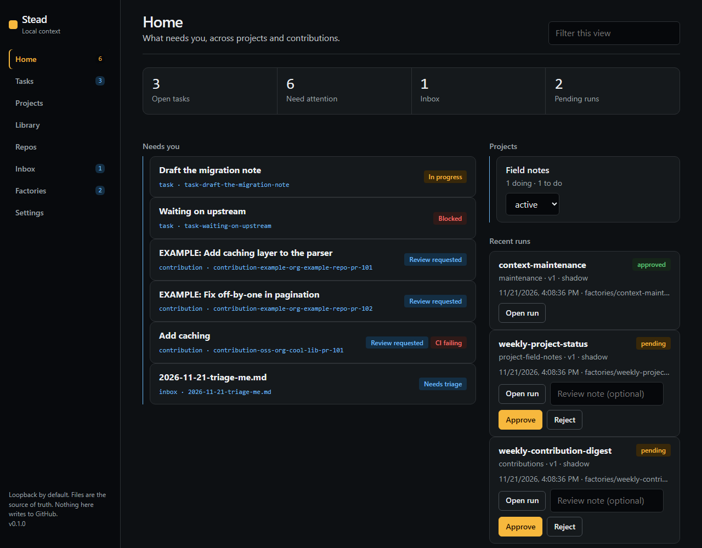

# Stead

**Rent the model. Own the context.**

[](https://github.com/TheShinySylveon/stead/actions/workflows/ci.yml)
[](LICENSE)
[](docs/getting-started.md)

Notion described [a new shape for work](https://www.notion.com/nsfw): projects,
tasks, documents, and meetings connected in one graph, instead of files
scattered across a dozen tools. Stead takes that shape and makes it executable.

Stead runs that graph locally — plain markdown you can read, diff, and own —
with two readers over the same files. You browse it as a wiki; an agent reads a
scoped bundle and gets to work. Each repo has one dial for how far that work may
go (draft a plan, open a pull request, or merge), and every delivered build
writes a versioned record back into the graph, so the next run learns from the
last.

The twist is execution, not filing. A factory doesn't stop at a draft: with a
model configured, it plans, writes the code, runs the repo's checks, and can
deliver under that repo's ceiling. Notion gave work a shape; Stead gives it a
way to get done.

Built for the solo open-source contributor: a dozen repos, a weekly review
queue, and no vendor holding your notes. The same files work for a small team
behind one container.

> **Status: working toward the [MVP](docs/mvp.md).** One reliable issue → spec
> → tested change → PR loop, reviewed by a human. The loop runs end to end on a
> local 27B model: Stead built [#20](https://github.com/TheShinySylveon/stead/pull/20),
> [#30](https://github.com/TheShinySylveon/stead/pull/30), and [#34](https://github.com/TheShinySylveon/stead/pull/34), all passed
> CI and were merged by a person with no edits. It is not measured yet; the scored run
> ([Dogfood](docs/dogfood.md)) comes next, and everything else waits until it passes.

## Quick start

Requires Python 3.11+. No pip packages.

```bash
git clone https://github.com/TheShinySylveon/stead.git
cd stead
python -m stead ui
```

Open **http://127.0.0.1:8765/**. A fresh checkout shows Welcome — name a
project and you're in. No browser? `python -m stead welcome --title "My Project"`.




## What you get

- **One connected graph.** Projects, tasks, documents, meetings, and repos linked
  by relations in flat-YAML-frontmatter markdown. Git is the audit trail.
- **Two readers.** Agents get scoped bundles; people get a Confluence-style wiki.
  No second store to drift.
- **One dial per repo.** A factory stops at a shadow plan, opens a draft or
  normal PR, or merges — never inherited, never bypassing branch protection.
- **Factories that execute.** Four pipelines — contribution digest, project
  status, feature-builder, context maintenance — plan, assemble, and (with a
  model) edit code, run checks, and deliver under the repo's ceiling.
- **Write-back.** A delivered build writes a versioned `build-record`; decisions
  and glossary terms are only *proposed* to the inbox, never quietly written.
- **A browser cockpit or the CLI.** The same actions either way, plus an
  optional shared Docker server ([deploy](docs/deploy.md)).

## Safety

Stead can run code and merge it. The threat model, the merge gates, and exactly
what leaves the machine: **[docs/trust.md](docs/trust.md)**. It's 0.1.0 — the
known limits (shared-server roles, check sandboxing, reviewer strength) live
there too.

## Documentation

| | |
|---|---|
| [Getting started](docs/getting-started.md) | Requirements, clone, first command |
| [MVP](docs/mvp.md) | The one loop that must work; everything else is deferred |
| [First run](docs/first-run.md) | Welcome, and what it refuses to do |
| [Concepts](docs/concepts.md) | Files, the index, public and private, the glossary |
| [Trust](docs/trust.md) | Threat model, merge gates, and what leaves the machine |
| [Cockpit](docs/cockpit.md) | The browser UI |
| [CLI](docs/cli.md) | Every command |
| [Factories](docs/factories.md) | The four workflows |
| [Models](docs/models.md) | The optional endpoint a factory drafts with |
| [Dogfood](docs/dogfood.md) | Stead manages Stead: the contract and the ledger |
| [Deploy](docs/deploy.md) | Docker, the image, and sign-in |
| [Several writers](docs/multi-actor.md) | Actors, git, and why SQLite stays |
| [Vision](docs/vision.md) | The autonomy slider and long-range design |
| [Roadmap](PLAN.md) | Design history and the §7 roadmap |
| [CONVENTIONS.md](CONVENTIONS.md) | Frontmatter schema. Read before writing objects. |
| [AGENTS.md](AGENTS.md) | Entry point for coding agents |

## Develop

```bash
python -m unittest discover -s tests -b
```

CI runs the suite on Python 3.11 and 3.12, Linux and Windows, plus `ruff`
(config in `ruff.toml`) and CodeQL. Merging to `main` publishes
`ghcr.io/theshinysylveon/stead`. AI review is optional and advisory: the
repo carries configs for CodeRabbit (`.coderabbit.yaml`) and Gemini Code
Assist (`.gemini/`), both free for public repositories once installed.

## License

Apache License, Version 2.0. Copyright 2026 Tyler Rathbone. See [LICENSE](LICENSE).
