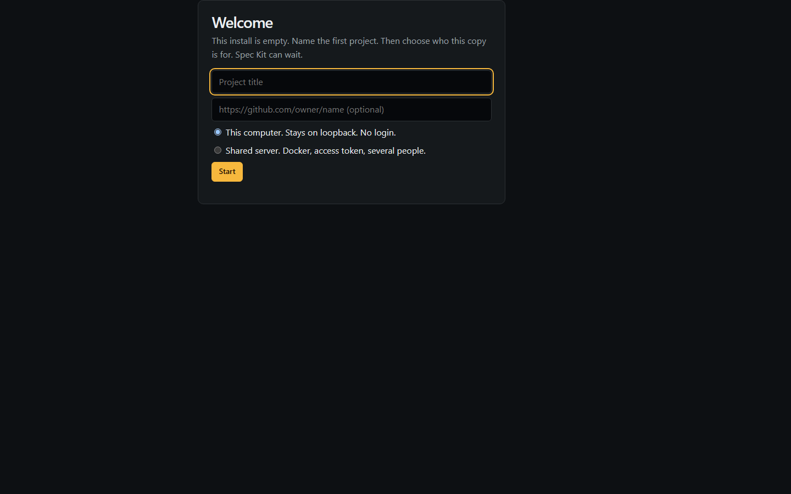

# Stead

[](https://github.com/TheShinySylveon/stead/actions/workflows/ci.yml)
[](LICENSE)
[](docs/getting-started.md)

Stead is a local implementation of the system in Notion's guidebook
[*A New Shape for Work*](https://www.notion.com/nsfw): a **context system**
(one organized place where people and agents read and write knowledge) plus
a few **factories** (shared, specific, scrutinized workflows on top of that
place). Notion describes the idea. Stead is one way to keep it in files you
own.

> Rent the intelligence. Own the context.

The model can be swapped. The files stay yours. The command is `ctx`.
Version **0.0.1**. Licensed under Apache-2.0. Copyright 2026 Tyler Rathbone.
See [LICENSE](LICENSE).


The cockpit, after the first project exists. The shot is a sample named Field notes, not data shipped with the repo.



A fresh checkout shows Welcome instead.

## What you get

- Markdown files with flat YAML frontmatter. That is the source of truth.
- A SQLite index (`state.db`) that `ctx init` can rebuild. It is not shared.
- A local cockpit in the browser, or the same actions from the CLI.
- Three factories that assemble a prompt. `--generate` drafts with the model
  you configure. The default still calls nothing.
- A first-run choice: this computer, or a shared Docker server with an access token.

Docs: [docs/README.md](docs/README.md).

## Quick start

Requires Python 3.11 or newer. No pip packages.

```bash
git clone https://github.com/TheShinySylveon/stead.git
cd stead
python3 -m ctx ui
```

A fresh checkout has an empty `context/`. Welcome asks for a project title, an
optional GitHub URL, and whether this copy is for this computer or a shared
server. Nothing is pushed.

Without a browser:

```bash
python3 -m ctx welcome --title "My Project"
```

## This computer or a shared server

| | This computer | Shared server |
|---|---|---|
| Who | One person, and the agents on that machine | Several people, one process |
| How | `python3 -m ctx ui` | `docker compose up --build` |
| Network | Loopback only | Published port, access token required |
| Index | One `state.db` on that machine | One `state.db` inside the container |

Choosing Shared server in Welcome does not open a port on your laptop. It
writes a gitignored `stead.json` and shows a token once. Start the container
only after you set `STEAD_ACCESS_TOKEN`. Details: [docs/deploy.md](docs/deploy.md).

Do not scale the container. Do not put `state.db` on a network share. People
who each have a clone share the markdown through git, and each clone keeps
its own index. [docs/multi-actor.md](docs/multi-actor.md).

## Factories

A factory is specific, shared, and scrutinized. Stead ships three. Each run
writes `bundle.md`, `prompt.md`, and `run.json` under `factories/<name>/runs/`
(gitignored). Add `--generate` to also write `output.md` from your model.
Hand `prompt.md` to any agent if you would rather not. Record the verdict
yourself.

| Factory | What it drafts |
|---|---|
| `weekly-contribution-digest` | PRs in flight, reviews waiting, claimed issues, CI |
| `weekly-project-status` | A status note from one project's tasks, docs, and meetings |
| `feature-builder` | A plan and proposed diff from a feature spec you authored |

`feature-builder` is planning-first on every run. `method: spec-kit` (the
default) uses the optional `specify` CLI when you onboard a code directory.
`method: builtin` is the same phases as markdown. Assembly itself never calls
a model and never pushes.

Shadow is the only mode the cockpit offers, and the CLI default. A draft pull
request is described in the prompt and is not implemented.

```bash
python3 -m ctx sync github --limit 30    # read-only, needs gh
python3 -m ctx digest                    # shadow digest
```

More: [docs/factories.md](docs/factories.md) and
[docs/spec-kit-workflow.md](docs/spec-kit-workflow.md).

## Documentation

| | |
|---|---|
| [Getting started](docs/getting-started.md) | Requirements, clone, first command |
| [First run](docs/first-run.md) | Welcome, and what it refuses to do |
| [Concepts](docs/concepts.md) | Files, the index, public and private |
| [Cockpit](docs/cockpit.md) | The browser UI |
| [CLI](docs/cli.md) | Every command |
| [Models](docs/models.md) | The optional endpoint a factory drafts with |
| [Deploy](docs/deploy.md) | Docker and the access token |
| [Several writers](docs/multi-actor.md) | Actors, git, and why SQLite stays |
| [CONVENTIONS.md](CONVENTIONS.md) | Frontmatter schema. Read this before writing objects. |
| [AGENTS.md](AGENTS.md) | Entry point for coding agents |

Samples live in `examples/context/`. They are not loaded into a fresh checkout.

## Develop

```bash
python3 -m unittest discover -s tests
```

CI on `main` and on pull requests runs that suite on Python 3.11 and 3.12,
then builds the Docker image. It does not push the image.

## Limits of 0.0.1

- No per-person passwords. A shared server has one access token.
- A normal `ctx ui` stays on loopback. `--deploy` and Docker are the only
  public binds, and they require the token.
- `actor:` is not stamped automatically. Add actors in Settings or with
  `ctx actor add`. Attribution is a file, not a login.
- A factory calls a model only when you pass `--generate` or check Draft
  with model. The endpoint is yours: OpenAI, Anthropic, Grok, or another
  chat server. The draft is a file. Nothing is posted, pushed, or merged.
- `specify` is optional. If it is missing, onboarding still writes the
  constitution in `context/documents/`.
- Git history before the empty-context commit still contains early demo
  files. A clone of `main` does not load them.

## Coming soon

- The remote step for feature-builder: push, open a pull request, or merge.
  The ceiling can be set now. The push is not built.
- Automatic `actor:` on each write.
- Per-person sign-in, instead of one shared token.
- Promote refuses until the eval cases for that prompt have recorded passes.
- A published container image. CI only builds it today.

## Contributing

Issues and pull requests are welcome. Read [AGENTS.md](AGENTS.md) and
[CONVENTIONS.md](CONVENTIONS.md) before adding objects. Run the tests before
you open a pull request:

```bash
python3 -m unittest discover -s tests
```

History of this release: [CHANGELOG.md](CHANGELOG.md).

## License

Apache License, Version 2.0. See [LICENSE](LICENSE).
